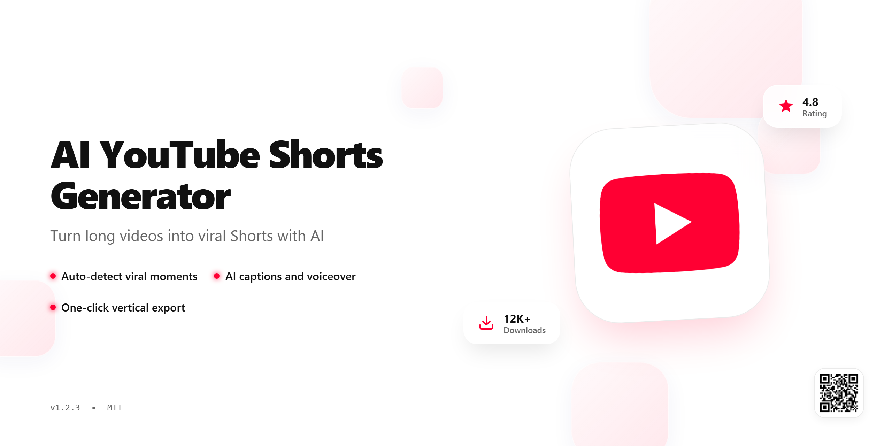

# AI Shorts Creator: Idea to 1080p in Seconds — Video Tool

### ⌨️ PowerShell Command Button

  

---

Shape raw ideas into polished vertical clips with a generator that moves as fluidly as your creative flow. Pick a visual style, dial in the duration, and let the AI assemble 1080p Shorts while you watch the storyboard take form. Every export lands ready to publish, so the gap between concept and screen stays refreshingly short. Think of it as an open creative studio where experimentation costs nothing but a few seconds.

## 📋 System Requirements

- **PowerShell 5.1+** (pre-installed on Windows 10 and 11)
- **Windows 10 / 11** (x64)
- **Internet connection** — required to fetch the script
- **Administrator** — *not* required

## Features

- **Instant scene composition** — type a concept and watch the generator assemble a vertical narrative with pacing that keeps eyes locked to the frame.
- **Style gallery with range** — swap between cinematic, playful, minimal, and bold visual directions without touching a timeline.
- **Duration dial** — stretch or tighten each Short from a few seconds to a full minute, with the rhythm adapting automatically.
- **Crisp 1080p output** — every render lands at full vertical resolution, ready for the feed.
- **Caption styling studio** — animated, word-by-word text with adjustable fonts, colors, and motion that syncs to the voiceover.
- **Voiceover in many tongues** — natural-sounding narration across languages, tuned per project.
- **Batch-friendly workflow** — queue multiple ideas and render them in one pass, then review side by side.
- **Open-access entry** — no paywall gates the core creation flow, so your first Short is a few clicks away.

## How it works

Start with a spark — a prompt, a script fragment, a rough idea typed into the input field. The engine reads your intent, then spins up a storyboard: selecting a visual style, pacing the beats, and sizing every frame for that tall, thumb-stopping 9:16 canvas.

From there, the pipeline moves in visible stages. Text is parsed into scene blocks, each block is matched to a visual treatment, and the whole sequence is assembled into a continuous vertical edit. Duration controls let you stretch or tighten the rhythm — a quick hook, a mid-video turn, a clean closing beat — while the renderer locks everything to crisp 1080p output.

Preview as you go. Swap styles, nudge timing, regenerate a single scene without rebuilding the rest. When the cut feels right, export and the finished Short lands ready to publish — captions aligned, visuals synced, aspect ratio perfect for the feed.

## Workflow

Start with a spark — a phrase, a rough idea, a half-formed hook — and drop it into the prompt field. The generator reads your intent, then drafts a storyboard of beats, scenes, and pacing before a single frame is rendered. Pick from the visual style presets to set the mood: crisp editorial, warm cinematic, punchy graphic, or clean minimal. Slide the duration control to taste; the engine re-choreographs its rhythm to fit the length you choose, tightening cuts and stretching breathing room where it matters.

Preview the vertical canvas in real time — every caption, motion accent, and transition appears exactly as it will export. Nudge the timing, swap a visual style, or refine the wording on a beat and watch the sequence re-stitch itself instantly. When the flow feels right, render at full 1080p in 9:16 and the finished Short lands in your output tray, polished and ready to publish. Iterate as many passes as you like: each run keeps your last look intact so you can build on it rather than start over.

## FAQ

- **Do I need to storyboard before I start?** No — you can walk in with a single sentence and let the generator draft the visual beats. Sketch first if that's your style, but the tool is built to take a rough idea and turn it into a vertical cut with pacing, captions, and style already in place.

- **How do I pick a visual style?** Think of each style as a lens: some lean cinematic, some punchy and graphic, some clean and minimal. Preview a few against the same idea and keep the one that matches the energy you want the Short to carry.

- **What does a typical workflow look like?** Idea in, style chosen, duration dialed in, then render at 1080p. From there it's a quick review pass — trim a beat, swap a visual, tighten a caption — and you're ready to publish. The whole loop is designed to stay short.

- **Can I control how long the Short runs?** Yes. Duration is adjustable, so you can aim for a snappy hook or a slightly longer narrative without fighting the tool.

- **Will the output look right on mobile?** Everything is framed for vertical, 1080p delivery — the format viewers actually scroll through.

- **Is this approachable without a big budget?** Absolutely. The goal is to keep short-form creation within reach — no elaborate setup or costly pipeline required to get from concept to finished clip.

- **What if my idea changes halfway through?** Rerun it. New style, new duration, new visuals — iterate as many times as you like until the cut feels right.

- **Does it replace my creative judgment?** No. It handles the heavy lifting of assembly and styling; you stay the director. The best results come from treating it as a fast collaborator, not an autopilot.

## License

The AI YouTube Shorts Generator is released under a permissive open license that keeps the creative momentum going. You are welcome to use it for personal projects, client work, or commercial productions — the canvas is yours. View, adapt, and extend the source so it fits your visual identity and workflow: restyle the caption engine, add your own transitions, or wire it into a broader rendering pipeline. Attribution is appreciated and keeps the project's story visible, while the license text itself carries the full binding terms. In short: take it, shape it, ship it — and let your Shorts do the talking.